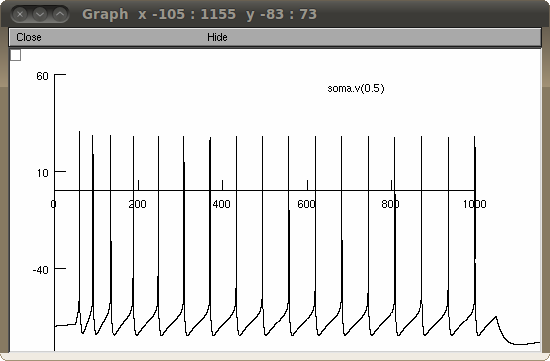

# Neuron model to probe effects of altered dendritic complexity

Author: Luuk van der Velden, University of Amsterdam, 2011  
Reference paper: Altered dendritic complexity affects firing properties of cortical layer 2/3 pyramidal neurons in mice lacking the 5-HT3A receptor [Link](http://jn.physiology.org/content/108/5/1521)  
PubMed ID: 22696545

# Introduction:

This model of a simplified layer 2/3 pyramidal model is based on earlier work by Mainen and Sejnowski (1996).  
It enables the manipulation of the dendritic complexity, as defined by the number of branch levels in the tree.  
The simplified model consists of binary symmetric dendritic trees with a fixed apical diameter.  
Rall's diameter rule is applied to calculate the diameters of the higher order branches.                

This model is provided **as is** and without warranty, purely for research and educational purposes, have fun!

# Motivation:

The model was created to look at the effects of altered dendritic complexity in layer 2/3 pyramidal neurons.  
The 5-HT3A knockout mouse was previously shown to express increased dendritic complexity in its layer 2/3 pyramidal neurons.  
With this model we accompanied our experimental findings and showed that altered dendritic complexity could explain many of the electrophysiological differences we found.

# Model makeup:

The model consists of a biophysical and morphological layout typical for cortical pyramidal neurons, based on previous efforts (a.o. Mainen and Sejnowski, 1996).  
We included calcium diffusion dynamics as described in the NEURON book (Carnevale and Hines, 2006).  
To allow study of dendritic complexity, the number of branch levels can be manipulated by changing the 'branch_levels' parameter from 0 to 6.  
The Rall diameter rule is applied to keep the dendritic trees passively equivalent.  
The model was written in one HOC file, with sections for Topology, Geometry, Biophysics, Instrumentation and Experimental control.  
It executes by calling its own initialization and run function, subsequently various parameters (voltages, calcium concentrations) are written to a text file, for further use.  
This model is identical to the one used to generate figures 4 (A to C) and figure 5.

# Usage:

To start the simulation demo either auto-launch under ModelDB or  

Under unix systems:  
to compile the mod files use the command 'nrnivmodl' and run the simulation hoc file with the command 'nrngui altered_complexity_model.hoc'

Under Windows systems:  
To compile the mod files use the "mknrndll" command. A double click on the simulation file altered_complexity_model.hoc will open the simulation window.

Once the simulation has started:  
there is a brief pause and then you should see the following figure:

---

2025-07-09: Converted README to Markdown.